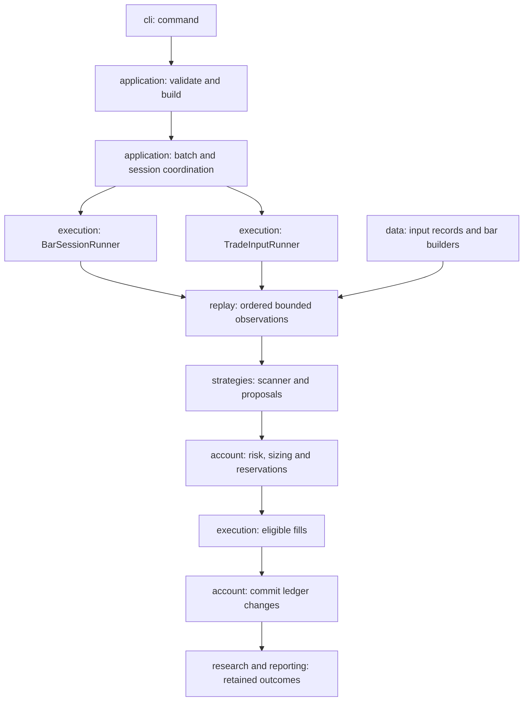

# Current package architecture

Updated 2026-10-30. This is the authoritative file-layout and model-ownership guide. [Current status](CURRENT_SYSTEM_AND_NEXT_STEPS.md) owns the capability/test inventory; [decisions](decisions.md) owns research choices. This reorganization does not add Alpaca access or change trading policies.

## Packages and ownership

All packages are under `src/rsys/`. Every package has `models.py`. Plain dataclasses, Pydantic schemas, named tuples, enums and small record wrappers belong there. Record validation, properties and pure conversion helpers stay with their records. Active services, state machines, I/O and ledger operations stay in separate modules. Exceptions live in `errors.py` where needed; protocols live at their behavior boundary.

| Package | Behavior modules | Models owned here |
|---|---|---|
| `cli` | `commands.py`, `fixtures.py`, `__main__.py` | `FixtureCaseOutcome`; argument parsing continues to use `argparse.Namespace` |
| `application` | `builders.py`, `run.py`, `batch.py`, `sessions.py`, `results.py`, `config.py`, `session_config.py`, `batch_config.py`, `registry.py`, `replay.py` | Configuration profiles, registry specifications, validation results, `SessionResult`, `SplitAction`, `ReplayRunResult` |
| `data` | `calendar.py`, `timestamps.py`, `bars.py`, `bar_builder.py`, `bar_version_store.py`, `bar_rules.py`, `quotes.py`, `actions.py`, `features.py`, `history.py`, `providers.py`, `parity.py` | Events, bars, snapshots/versions, keys, quotes, coverage/universe records, historical rows and feature results |
| `replay` | `clock.py`, `engine.py`, `runtime.py`, `views.py`, `validation.py` | `Phase`, `ReplayProfile`, `PhaseEvent`, dispatch/observation records |
| `strategies` | `orb.py`, `vwap.py`, `scanner.py`, `history.py`, `interfaces.py` | Shared `CompletedBar`, ORB/VWAP configuration and states, scanner candidates/results |
| `execution` | `bar.py`, `trade.py`, `trade_adapter.py`, `contracts.py`, `fixtures.py` | Fill transitions/records/outcomes, trade references, execution policy/costs, decisions and fixture results |
| `account` | `portfolio.py`, `acceptance.py`, `sizing.py`, `risk.py`, `money.py` | Proposals, accepted intents, positions, checkpoints, risk/sizing policies and rejection codes |
| `research` | `experiments.py`, `storage.py`, `evaluation.py`, `multi_session.py`, `comparison.py`, `holdout.py` | Run records/status, metrics, comparison assumptions, partition/access records |
| `reporting` | `html.py` | No additional report-only records yet; `models.py` documents reuse of research records and retained JSON |

`Portfolio` deliberately remains in `account/portfolio.py`: although implemented as a dataclass, it is a mutable transactional account aggregate with reservation, buy/sell and invariant behavior, not a plain model. `RiskMonitor`, replay engines, runners and strategy state machines likewise remain services.

## Execution and dependencies



Core data/account/replay/strategy/execution packages do not import CLI or application orchestration. Model modules may depend on other model/error modules and small validation/time/money utilities, never runners or storage services. `application/builders.py` constructs strategies and runners; batches no longer import construction helpers from a CLI/run module. `application/results.py` summarizes a session without invoking another run.

The history provider contract lives in `data/providers.py`. `data/history.py` contains the synthetic provider and dated history selection. `strategies/history.py` turns that history into scanner candidates. This is an explicit place to add a future audited provider; it is not an Alpaca adapter or a new historical-data capability.

## Public compatibility

- `uv run rsys ...`, `python -m rsys.cli ...` and `from rsys.cli import main` continue to work.
- The canonical bar runner is `rsys.execution.bar.BarSessionRunner`. The old `rsys.standalone_run.StandaloneRunner` name is an alias to the same class, with the legacy policy/record imports retained in that compatibility module.
- Other internal imports have intentionally moved. Use package `models.py` for records rather than relying on incidental re-exports from services.
- Both strategies now use the same `strategies.models.CompletedBar`; its fields are unchanged.
- Configuration schemas, serialized record fields, CLI exit codes and run artifact names are unchanged. Source fingerprints necessarily change; comparisons across source revisions remain guarded.

## Import migration

| Previous module | Canonical behavior module |
|---|---|
| `rsys.cli` | `rsys.cli.commands` |
| `rsys.config` | `rsys.application.config` |
| `rsys.registry` | `rsys.application.registry` |
| `rsys.run_cli` | `rsys.application.run` |
| `rsys.batch_config` | `rsys.application.batch_config` |
| `rsys.session_config` | `rsys.application.session_config` |
| `rsys.batch_run` | `rsys.application.batch` |
| `rsys.session_coordinator` | `rsys.application.sessions` |
| `rsys.calendar` | `rsys.data.calendar` |
| `rsys.features` | `rsys.data.features` |
| `rsys.scanner_history` | `rsys.strategies.history` |
| `rsys.parity` | `rsys.data.parity` |
| `rsys.replay` | `rsys.replay.clock` |
| `rsys.replay_runtime` | `rsys.replay.runtime` |
| `rsys.phase_engine` | `rsys.replay.engine` |
| `rsys.views` | `rsys.replay.views` |
| `rsys.replay_io` | `rsys.application.replay` |
| `rsys.replay_validation` | `rsys.replay.validation` |
| `rsys.standalone_run` | `rsys.execution.bar` |
| `rsys.trade_input_run` | `rsys.execution.trade` |
| `rsys.trade_execution` | `rsys.execution.trade_adapter` |
| `rsys.execution_contract` | `rsys.execution.contracts` |
| `rsys.fixture_engine` | `rsys.execution.fixtures` |
| `rsys.orders` | `rsys.account.models` |
| `rsys.money` | `rsys.account.money` |
| `rsys.portfolio` | `rsys.account.portfolio` |
| `rsys.sizing` | `rsys.account.sizing` |
| `rsys.acceptance` | `rsys.account.acceptance` |
| `rsys.risk_policy` | `rsys.account.risk` |
| `rsys.scanner` | `rsys.strategies.scanner` |
| `rsys.storage` | `rsys.research.storage` |
| `rsys.experiments` | `rsys.research.experiments` |
| `rsys.holdout` | `rsys.research.holdout` |
| `rsys.evaluation` | `rsys.research.evaluation` |
| `rsys.multi_session_evaluation` | `rsys.research.multi_session` |
| `rsys.compare_cli` | `rsys.research.comparison` |
| `rsys.report` | `rsys.reporting.html` |
| `rsys.fixture_cli` | `rsys.cli.fixtures` |

For the former `scanner_history` module, provider classes moved to `data.history`/`data.providers`, records to `data.models`, and scanner composition to `strategies.history`. For every other row, import plain records from that package's `models.py`; the behavior-module column is not a promise to re-export them. Existing `data/*` record definitions likewise moved to `data/models.py`.

## Verification

`tests/test_package_structure.py` checks every package's model namespace in a fresh process, all runtime-module imports, model ownership, dependency direction, CLI module execution and the legacy runner alias. Existing test assertions continue to exercise the same account, replay and public-run behavior under canonical imports.

Run:

```bash
uv run pytest tests/ -q
uv run ruff check .
uv run rsys run --config fixtures/sessions_bar_fixture.json --out runs/bar --report
uv run rsys run --config fixtures/sessions_trade_fixture.json --out runs/trade --report
```

Verified: **763 tests pass**, Ruff is clean, and all **25 public CLI invocations** return their expected exits. All **18 generated semantic traces** match revision `dab3185` exactly, with unchanged account metrics. The wheel build includes all nine model namespaces and the public compatibility entry points. Historical inputs, provider semantics, full equal-timestamp trade execution and final-evaluation enablement remain outside this change.
