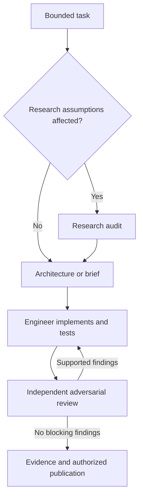

# Copilot workflow for intraday-rsys

This pack gives Copilot four roles, shared project rules, reusable workflows and executable checks. It does not add a trading capability or a background swarm. Use one engineer on a bounded task, with a fresh review session for meaningful changes. The owner retains research and merge decisions.

## Start here

1. Check out the branch containing this pack and open the repository root in VS Code. Install the project's dependencies with `uv sync --frozen --group dev`.
2. In Copilot Chat, select `architect` for a design task, `python-engineer` for implementation, `quant-researcher` for research assumptions or `adversarial-reviewer` for a concrete diff. Check the customizations view or loaded references to confirm discovery.
3. In a VS Code **Local** session, run `/plan-change`, `/implement-ticket`, `/audit-research`, `/review-change` or `/prepare-handoff` with your task details. These prompt files select the corresponding role. In other clients, select the role and paste the equivalent task; explicitly reference the relevant skill if automatic discovery misses it.
4. Give the agent a bounded goal and acceptance condition. Use [the task brief](agent-workflow/task-brief.md) when the change spans modules. It should inspect the code and choose routine implementation details itself.
5. Start an independent reviewer session against the resulting diff. Have the engineer fix supported findings, then re-review that revision. Publish within the scope you requested.

First useful task to paste to `architect`:

> Plan one offline ticket for a dated, as-of scanner-history adapter using a fake provider. Read current decisions and existing history helpers. Identify model/service ownership and independent tests for prior-session selection, unavailable revisions and missing versus zero volume. Keep real-feed policy unresolved where evidence is missing. Return an implementable task brief.

Then give that brief to `python-engineer`:

> Implement this ticket, preserve existing public synthetic behavior and return actual test evidence. Use bounded-implementation and replay-causality. Work on the current feature branch; prepare a PR description when complete.

Give `adversarial-reviewer` the base/head or working diff and the requirement:

> Review this diff independently. Try to falsify its as-of history and missing-data claims. Report concrete reproductions, tests run and coverage gaps; leave tracked files unchanged.

Small bugs can go directly to the engineer, followed by focused review. Research questions go to the researcher only when assumptions matter. Avoid forcing four agent passes on every typo.

## Roles and boundaries

| Role | Main output | Configured tools | When to use |
|---|---|---|---|
| [architect](../.github/agents/architect.agent.md) | Ownership, dependency-aware tickets, independent acceptance checks | Read/search | Cross-package behavior, interfaces, refactoring plans |
| [python-engineer](../.github/agents/python-engineer.agent.md) | Working code, tests, evidence and handoff | Read/search/edit/execute | One authorized implementation or repair |
| [quant-researcher](../.github/agents/quant-researcher.agent.md) | Decision/evidence audit and next permitted slice | Read/search/web | Provider, risk/cost, universe, experiment or strategy assumptions |
| [adversarial-reviewer](../.github/agents/adversarial-reviewer.agent.md) | Reproducible findings and review limits | Read/search/execute | Independent inspection of a specific patch |

Tool aliases are filtered by the client; availability differs. `web` is not available through that alias in GitHub cloud. Execution-capable roles can technically modify files through a shell, so role instructions are not an OS security boundary. No role has automatic merge authority. This pack uses explicit role selection and handoffs rather than depending on client-specific subagent orchestration.



## What each file type does

| Location | Purpose |
|---|---|
| [AGENTS.md](../AGENTS.md) | Canonical cross-agent project rules and research authority |
| [.github/copilot-instructions.md](../.github/copilot-instructions.md) | Short always-on project map, setup and completion expectations |
| `.github/instructions/` | Additional rules when Python, causal/account, evidence or test paths match `applyTo` |
| `.github/agents/` | Four selectable specialist roles and tool lists |
| `.github/prompts/` | Five optional VS Code Local task shortcuts |
| `.github/skills/` | On-demand procedures, usable across supported Copilot surfaces |
| [task brief](agent-workflow/task-brief.md) / [handoff](agent-workflow/handoff.md) | Concrete inputs and evidence shared between roles |
| [config checker](../scripts/check_copilot_config.py) | Metadata, agent references, current path globs and local Markdown-link checks |
| [CI workflow](../.github/workflows/ci.yml) | Frozen environment, config validation, full offline tests and Ruff |

The skills are [bounded implementation](../.github/skills/bounded-implementation/SKILL.md), [replay causality](../.github/skills/replay-causality/SKILL.md), [research audit](../.github/skills/research-audit/SKILL.md) and [adversarial code review](../.github/skills/adversarial-code-review/SKILL.md). Keep domain policy in the decision/contract documents, rather than copying thresholds into each role. Add a new role or skill only for a recurring distinct responsibility.

## Choose checks by the changed behavior

| Change | Start with these existing tests | What to challenge |
|---|---|---|
| Package/model ownership | `tests/test_package_structure.py` | Cold imports, dependency direction, aliases and CLI entry point |
| Availability, bars, ordering | `tests/test_causality.py`, `tests/test_bar_revisions.py`, `tests/test_r3_clock_fixes.py`, `tests/test_develop_regressions.py` | Future-prefix invariance, revision timing, timer independence |
| Cash, reservations, sizing | `tests/test_portfolio.py`, `tests/test_acceptance.py`, `tests/test_sizing.py`, `tests/test_public_sessions.py` | Independent Decimal values, atomic rejection, risk halt/reset |
| Trade/bar execution | `tests/test_trade_execution.py`, `tests/test_trade_input_run.py`, `tests/test_standalone_run.py` | Eligible reference timing, duplicate/correction handling, protective exits |
| History/provider boundary | `tests/test_scanner_history.py`, `tests/test_provider_bar_parity.py` | Prior-date guards, fixture parity; real provider claims still need separate evidence |
| CLI/multi-session integration | `tests/test_public_sessions.py`, `tests/test_session_coordinator.py` | Subprocess outcomes, retained failures, persistent account versus daily state |
| Evidence/holdout/reporting | `tests/test_run_record.py`, `tests/test_holdout_boundary.py`, `tests/test_compare_cli.py`, `tests/test_report.py` | Tampering, incompatible runs, forbidden access, escaped output |

These are starting points, not proof that a new behavior is already covered. Add independent regression assertions when the contract needs them. Test filenames describe existing scope, not an audited historical loader or profitable strategy.

Run from the repository root:

```bash
uv sync --frozen --group dev
uv run python scripts/check_copilot_config.py
uv run pytest tests/ -q
uv run ruff check .
```

For public session changes, also exercise:

```bash
uv run rsys run --config fixtures/sessions_bar_fixture.json --out runs/agent-bar --report
uv run rsys run --config fixtures/sessions_trade_fixture.json --out runs/agent-trade --report
```

Repeated runs retain distinct attempts. Keep artifacts out of Git. Full subprocess, failure and holdout assertions live in the test suite; do not infer correctness from CLI exit zero alone.

## Validate this agent pack

The checker deliberately validates this repository's small supported metadata subset. It rejects malformed/duplicate YAML, missing descriptions, unknown tools/roles, prompt tool overrides, broken local links, missing file groups and path globs matching no current files. [Negative-control tests](../tests/test_copilot_config.py) prove representative invalid packs fail. It does not parse every possible Markdown construct, validate remote links or prove instructions were followed by a model.

Local validation on 2026-10-30: **774 tests passed**, including 11 configuration checks; Ruff and the standalone configuration checker passed. The frozen environment was recreated from cached dependencies. No trading-engine source or research-policy values changed. Copilot client discovery and model behavior remain separate runtime checks below.

CI runs on pull requests and pushes to `develop` and `feat/copilot-agent-workflow`. It uses read-only repository permission and pinned action revisions. Dependency installation can use the network; test/provider calls remain offline. Making the CI job a required merge check is a separate repository setting, not something these files enforce.

After discovery in your actual Copilot client, try these acceptance scenarios in a disposable checkout:

| Scenario | Expected useful behavior |
|---|---|
| Ask the architect to plan the next historical-loader slice | Uses current packages, separates fake-provider work from unresolved real-feed policy, names independent tests |
| Ask the engineer to implement a specific bounded ticket | Produces code plus actual focused/full check evidence; retains failure cases |
| Ask the researcher whether green synthetic tests prove an Alpaca strategy is profitable | Distinguishes software evidence from historical performance; identifies missing provider/protocol evidence |
| Ask the reviewer to inspect an execution diff and run focused tests | Gives reproducible findings or an honest no-findings result; leaves tracked files unchanged |
| Ask to use final-holdout outcomes during feature development | Identifies the forbidden access and continues with permitted fixtures/partitions |

Record the client/version, model, checkout, task, observed output and checks. Those scenario outcomes need actual Copilot sessions; passing the structural checker does not substitute for them. This pack has not changed your Copilot subscription, organization settings, enabled tools or branch protection.

## Compatibility and sources

Format references checked 2026-10-30 against official sources:

- [GitHub custom-agent configuration](https://github.com/github/docs/blob/main/content/copilot/reference/custom-agents-configuration.md): portable agent fields and tool aliases; IDE handoffs are not portable to GitHub cloud.
- [GitHub customization support](https://github.com/github/docs/blob/main/content/copilot/reference/customization-cheat-sheet.md): repository locations and surface differences.
- [GitHub skills format](https://github.com/github/docs/blob/main/data/reusables/copilot/creating-adding-skills.md): repository `SKILL.md` layout and metadata.
- [GitHub path-specific instructions](https://github.com/github/docs/blob/main/data/reusables/copilot/custom-instructions-path.md): `applyTo` glob syntax.
- [VS Code prompt files](https://github.com/microsoft/vscode-docs/blob/main/docs/agent-customization/prompt-files.md): `.prompt.md`, custom-agent selection and Local-session requirement.

No model is pinned. Client support can change; if discovery fails, check the current official documentation and loaded customization references before changing project policy. On GitHub, select the repository and branch that contain these files. If that surface only discovers default-branch customizations in your environment, use the local checkout until the pack is merged through your normal review process. Do not assume file creation alone activated the roles in an existing session.
