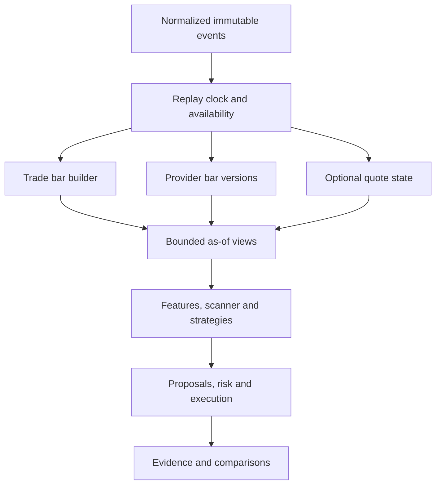

# Implementation to-do and next steps: reliable research replay

> Historical planning or implementation record. Starting-state descriptions and paths reflect its original revision. Use [ARCHITECTURE.md](ARCHITECTURE.md) for current packages and [CURRENT_SYSTEM_AND_NEXT_STEPS.md](CURRENT_SYSTEM_AND_NEXT_STEPS.md) for current status. Behavioral requirements still apply unless superseded by the decision register.

Updated: 2026-10-28 (America/Denver). Based on the uploaded `intraday-rsys` snapshot at commit `457fb88` and the subsequent independent review. Proposed repository destination: `docs/IMPLEMENTATION_TODO_AND_REPLAY_PLAN.md`.

This document is an implementation handoff, not a claim that the changes have been built. It supersedes the immediate next-task guidance in the older `NEXT_STEPS.md`; retain the product goals, existing requirement IDs, strategy definitions, and M2/M3 research sequence. Recheck the working branch before editing.

## 1. Outcome and the new requirement

Build a trustworthy path from market observations to inspectable strategy decisions, trades, account results, and controlled comparisons. Preserve the core flow:

Configure experiment → select eligible universe → replay available events → update positions/features → scan → evaluate strategies → propose trades → apply risk checks → execute accepted orders → record results.

**User requirement:** when the input includes individual trades, construct an in-progress bar as those trades become available, using the selected provider/feed's aggregation rules. Retain completed-bar replay and optional quote input.

The previous contracts cover completed historical bars, separate execution open events, and as-of availability. They do **not** yet define a trade-driven bar builder, revision lifecycle, or quote-state interface. Add these before treating replay as complete.

| Input | What the system can legitimately expose |
|---|---|
| Completed one-minute OHLCV bars | That minute's completed values only at declared availability; no invented within-minute path |
| Individual trades | An evolving trade-derived bar using only observations available so far |
| Recorded provider bar updates | Versioned snapshots when each update was actually received |
| Quotes, if the feed permits access | Separate bid/ask state and spread features; no contribution to stock trade-bar volume or trade OHLC |
| Completed smaller bars forming a larger interval | A partial larger bar at the smaller bars' availability; no finer resolution than the source supports |

Keep `orb_close_cross_v1` and VWAP touch-and-hold on completed-bar decisions initially. Building an in-progress bar does not silently change their entry rules. Intrabar strategies are separate named variants with a declared evaluation cadence and comparison experiment.

## 2. Current state and immediate checklist

The independent review reproduced 126 existing passing tests, fixture validation exit 0, and 44 pending research blockers with exit 2. It did not reproduce a fresh frozen `uv` installation or Ruff run because the required Linux tooling/packages were unavailable locally. Those checks remain required in the implementation environment. Passing tests did not cover all the defects below.

**Status (2026-10-29): every row below is implemented.** P0 through R3 were built across several passes, then `docs/REPLAY_CORRECTIONS_AND_R3_HANDOFF.md` reproduced and fixed ten further defects/inspection gaps (C01-C10) on top of that baseline and completed R3's remaining quote-state/parity/CLI scope. Full suite: 348 tests passing (`uv run pytest tests/ -q`); `uv run ruff check .` clean. M2 (ledger, execution, scanner, strategies) remains entirely unimplemented and is the next dependency.

- [x] **P0 — Reconcile docs and ticket scope.** Register the trade-driven bar requirement, input modes, and unresolved provider details.
- [x] **H1 — Finish M0-01 validation.** Close the verified type/schema/gate/error gaps.
- [x] **H2 — Finish M0-02 evidence.** Fix source fingerprints, interruption/recovery, transactional consistency, and credential handling.
- [x] **D1 — Finish M1-01 data contracts.** Normalize bars/events/timestamps and implement coverage/exclusion records, including DATA-002.
- [x] **R1 — M1-02a clock and views.** Implement chronological, deterministic replay with immutable bounded access.
- [x] **R2 — M1-02b bar builder.** Build evolving bars from trade fixtures and preserve revisions/corrections.
- [x] **R3 — M1-02c integrated replay.** Wire bars/trades and optional quote state; prove causal prefix invariance and deterministic replay.
- [ ] **M2-01 — Ledger and conservative bar execution.** Run F01–F17 through actual account code.
- [ ] **M2-01T — Simple trade-event execution adapter.** Required before evaluating trade-input strategy P&L; it may follow the bar-based research path.
- [ ] **M2-02/03 — Scanner, ORB, VWAP.** Keep each contribution independently replaceable.
- [ ] **M2-04 — Inspectable synthetic research runs.** Connect CLI, trade trace, metrics, comparison checks, and holdout boundary.
- [ ] **M3 — Controlled comparisons.** Implement entry/exit/scanner studies and frozen uncertainty/promotion rules before optimization.

The H1/H2/D1 corrections take priority over new research features. Do not treat a missing test in a completion command as permission to omit a documented requirement. Implement one ticket at a time and retain failed evidence.

## 3. Provider facts and boundaries

Official documentation checked on 2026-10-28:

- Alpaca stock aggregation uses trade conditions, tape, and interval type to determine field eligibility. Price fields, volume/count, and VWAP need not use identical contributing trades; multiple conditions combine restrictively. The current FAQ describes SIP-timestamp bucketing. [S1]
- The stock stream provides trades, quotes, bars, later bar updates, and correction/cancel messages. Initial minute publication is not a guarantee that a bar will never change. Feed access depends on subscription. [S2]
- Historical trade and quote results are grouped by symbol and paginated. Their download order is not a global chronological replay order. [S3, S4]

**Design consequence:** implement a versioned `BarRules` adapter, not a universal “every print updates everything” function. Store the source URL, retrieval date, selected feed/tapes, and rule-table hash. Test each supported condition and combination against that specification. Unsupported rules block the affected data rather than being guessed.

The older Alpaca learning article uses participant-timestamp wording [S5], whereas the current FAQ says SIP timestamp [S1]. Resolve the actual field mapping/order semantics for the chosen endpoint/feed and record the result before claiming provider parity. This does not prevent synthetic development with explicitly declared fixture rules.

A historical download may already contain revised trade/bar information. Without original arrival and correction-delivery history, it cannot reproduce exactly what a live strategy knew. Label those runs as historical reconstruction with a declared availability model. Recorded-arrival replay is a distinct evidence class. Do not transform a historical update/status flag into a fabricated correction arrival time.

Quote support in the design does not establish access to a particular feed or historical window. Audit D12 before acquisition; no subscription or purchase is selected by this plan.

## 4. H1 — Configuration hardening

**Files:** `config.py`, `registry.py`, `cli.py`, `tests/test_config.py`, configuration documentation.

1. Restrict schema versions to implemented versions. Reject booleans before integer coercion for counts, budgets, seeds, versions, and delays. Preserve legal seed zero and explicitly configured zero costs/delays.
2. Require offset-free exchange-local cutoff times in the documented format. Enforce known date relationships even if an unrelated endpoint is still missing; retain all named missing-value blockers.
3. Reject blank required identifiers and blank list elements. Gate method references must resolve to declared versioned specifications or remain unresolved. A string such as `defined` is insufficient. Do not invent resampling methods or market thresholds.
4. Catch decoding errors as controlled config failures. Format safe messages from error categories and field paths; custom validator messages must not leak values.
5. Add the replay configuration contract described in section 9 when D1/R1 need it. Validate mode-specific dependencies without requiring quote access for a trades-only run.

**Regression checks:** schema 999; booleans as limits/budgets; `11:00+05:00`; partial reversed intervals; blank stress scenarios; placeholder methods; invalid UTF-8; fake canaries in custom errors; fully populated synthetic positive cases.

**Done:** `uv run pytest tests/test_config.py` and scoped Ruff checks pass. The pending profile has the exact justified blocker set and decision mapping; do not target a specific count.

## 5. H2 — Run evidence hardening

**Files:** `experiments.py`, `storage.py`, `tests/test_run_record.py`; add focused recovery/provenance tests if useful.

1. **Content provenance:** retain the Git commit as metadata and separately hash canonical relevant source contents, relative paths, rule tables, config, data manifest, and lockfile. Include relevant uncommitted/untracked source. Exclude credentials, environments, caches, and output folders. Two different dirty source trees must produce different fingerprints. Record the manifest used to compute the hash.
2. **Data identity:** require nonblank validated identity or a meaningful explicit not-applicable reason; reject contradictory declarations. A research runner must not accept missing required provenance merely because a sentinel is nonempty.
3. **Transactions:** prefer one local SQLite transaction for state and its transition history. JSON can be a derived export. If retaining a journal, add commit IDs, payload integrity, and actual reconciliation logic. Record replacement alone does not make two files atomic.
4. **Lifecycle:** handle `KeyboardInterrupt`/supported cancellation paths, persist `interrupted` when possible, and re-raise. Do not pretend a force-killed process cleaned up. Do not overwrite an already finalized outcome during context-manager exit.
5. **Recovery ownership:** store process/run ownership and use an exclusive recovery lock or equivalent policy. Recovery must not mark a live run crashed. Test a real child process that is stopped, plus an active run that must remain running. Avoid complex distributed infrastructure.
6. **Credential boundaries:** exclude credentials from run input artifacts; inject them through a dedicated runtime secret interface when a future adapter needs them. Sanitize errors independently of whether a record was reloaded. Include fake snake-case, camel-case, and provider header/environment-name canaries. Do not store raw secret values to solve reloading.
7. **Paths:** either restrict IDs to a single safe component or implement consistent recursive listing/recovery. Preserve existing attempts and reject traversal.

**Required failures to inject:** before state commit, between transactional operations, during initial creation, and after a committed transition. Reopening storage must yield one truthful committed state and consistent history. Finalized attempts cannot resume. Add source-change and reload/redaction tests.

**Done:** `uv run pytest tests/test_run_record.py` plus any new focused tests; full suite and lint at integration. Document migration of existing evidence without rewriting its history or deleting failed attempts.

## 6. D1 — Typed market data and coverage

**Files to add/extend:** `data/events.py`, `data/bars.py`, `data/actions.py`, `data/manifest.py`, `calendar.py`; `tests/test_market_events.py`, `test_universe_manifest.py`, and existing data/calendar tests.

### Immutable event envelope

Use a discriminated event kind and frozen payload. Preserve provider timestamp precision: nanosecond-capable UTC storage or integer nanoseconds, not an accidental microsecond truncation. Use Decimal for prices/sizes/money and integer counters where appropriate.

Common fields: stable event ID; instrument identity; provider/feed; event timestamp and its declared meaning; received timestamp if recorded; replay availability; original source sequence/capture ordinal; revision; raw payload reference/hash; session/unit version; quality state; recorded-versus-modeled timing label.

Different timestamps serve different purposes: the provider-defined market time assigns the interval; availability determines when the strategy may know the event. Preserve both. Never globally re-sort a recorded stream by market time and thereby expose late information early.

| Payload | Required content |
|---|---|
| Trade | Price, size, trade ID scope, venue/tape, condition codes, original provider timestamp |
| Trade correction/cancel | Reference to the original identity; replacement or cancellation details; its own availability |
| Quote | Bid/ask prices and sizes with explicit units, venue/conditions, feed identity and availability |
| Provider bar | Start/end, interval, OHLCV, available count/VWAP fields, adjustment mode, revision and availability |
| Corporate action | Existing action fields plus timezone validation, unit conversion provenance, and affected-data invalidation |
| Timer/session | Explicit scheduled boundary and its calendar/rules version |

Create `NormalizedBar` with identity, interval bounds, availability/revision, OHLCV, price-unit version, source and quality metadata. `RawBar` alone is not this contract. Canonicalize equivalent UTC representations before identity comparison. Validate interval length/alignment and forbid unavailable/future values from the public view.

Timezone parsing must reject malformed timestamps, unknown zones, unresolved DST folds, and nonexistent local times. A named zone alone does not disambiguate a repeated clock time. Keep the declared 2024 calendar for initial fixtures; extending coverage requires its own versioned schedule and tests.

### DATA-002 must be implemented here

The manifest declares requested and observed coverage by instrument/feed/session, historical universe basis, exclusions and reasons, calendar version, corporate-action coverage, timing provenance, rules version, gaps, input hashes, and data precision. Distinguish a verified no-trade interval from missing delivery. Neither means “invent a flat candle.” Emit exclusions as data, not only log text.

**Done:** existing DQ/TZ tests plus strict timestamp, nanosecond boundary, interval, identity, late-split invalidation, and universe-manifest tests pass. A later-discovered essential split invalidates affected evidence; checking its dispatch timestamp alone is insufficient.

## 7. R1–R3 — Replay, forming bars, and revisions



### R1: clock and access boundary

**Files:** `replay.py`, `views.py`, shared event enums; `test_event_order.py`, `test_causality.py`.

- One availability clock across all symbols. Sort deterministically using versioned event phases and recorded source sequence; use declared stable tie keys only where sequence is absent. Changing file/page order must not change an identified stream; changing its actual arrival sequence is a different experiment.
- Make the complete same-time input batch available before baseline cross-symbol ranking. Do not demand observations from symbols with no event; use explicit coverage/staleness rules.
- Snapshot views are immutable. `closed_bars(...)`, `forming_bar(...)`, `latest_trade(...)`, and `latest_quote(...)` expose only what was available at the snapshot key. Default baseline strategy context grants completed bars only; explicitly declared variants can request additional capabilities.
- Schedule boundary/session timers independently of receiving another trade. A final minute with no later tick still receives its scheduled closure. EOF before a required closure/coverage boundary marks the run incomplete.
- Keep the existing `bar_v1` phase contract intact. Add a separate, documented `trade_replay_v1` profile; do not silently reinterpret existing fixture timing.

Proposed extension for the trade profile, using the existing phase numbers: keep 10–30 for existing settlement, closed-bar publication, known actions/cash events, and timers; add **35 MARKET_DATA_APPLY** for trades/quotes/corrections and **37 BAR_UPDATE_PUBLISH** for immutable forming/revised snapshots; retain 40/50/60/70/80. Scheduled phase-20 closures use information processed before that boundary; a same-boundary arrival for the old bucket becomes a later phase-37 version. New-unit observations follow action processing. Scanner decisions run once on the phase-40 batch snapshot. A same-boundary correction can affect that snapshot but never an already recorded earlier decision.

Specify and test the queue rules before implementation: derived events cannot be inserted into a phase already completed; processing sequence is stable within a phase; old-unit late data across a split is blocked under the existing contract. Phase 10 settlement and phases 60/70 execution are inactive in the data-only R1–R3 slice. Event ordering must never grant permission to fill on the same trade that created an order.

**Done:** bounded access, same-time batching, stable order, timers/EOF, and mutation-resistance tests pass using synthetic events.

### R2: provider-rule-driven incremental bars

**Files:** `data/bar_builder.py`, `data/bar_rules.py`, `data/providers/alpaca_rules.py`, versioned rule fixture; `tests/test_bar_builder.py`, `test_bar_rules.py`, `test_bar_revisions.py`.

Suggested interfaces: `rules.classify(trade, interval)`, `builder.on_trade(event)`, `builder.on_correction(event)`, `builder.on_cancel(event)`, `builder.advance_clock(now)`, and `builder.snapshot(key)`. Names are implementation choices; responsibilities are the contract.

1. Assign each trade to a half-open interval using the pinned provider timestamp mapping. Arrival affects availability, not the bucket identity.
2. Ask the rules adapter for per-field contribution permissions and ordering semantics. Keep the aggregate's field contributors and sufficient statistics separate. Preserve the raw input and decision explaining any excluded contribution.
3. Update internal state on each accepted available event. Publish a new immutable forming snapshot; consumers cannot see later events through a shared mutable reference.
4. Distinguish **FORMING**, **CLOSED_AS_OF**, and subsequent **REVISED** versions. Interval completion does not promise that no correction can ever arrive. A separate frozen input manifest defines the reproducible retrospective dataset.
5. Keep a revision index and original-trade references sufficient to remove/recompute contributions. Correcting/canceling an extreme or first/last contributing trade requires recomputation; subtracting volume alone is insufficient. Unknown originals or evicted required state must yield a named incomplete/error state, not silent success.
6. A late event updates the proper earlier bucket at its present availability. Preserve old snapshots and prior decisions. Derived rolling features may incorporate the revision going forward, with the input version recorded. Do not reissue a past entry signal as if it happened earlier.
7. Preserve no-price/partial states. A volume contribution does not establish a tradable price. Price-dependent features remain unavailable until their requirements are satisfied.
8. Deduplicate by the adapter's declared identity scope. An identical delivery is idempotent; conflicting payloads need explicit revision/correction handling.
9. Bound memory with a declared retention/checkpoint policy and an immutable underlying event log. Measure storage/runtime before optimizing. Do not drop corrections outside the in-memory window without marking their effect unresolved.

### R3: wiring, optional quotes, and provider parity

**Files:** replay/view integration, `data/quotes.py` if enabled; `test_replay_inputs.py`, `test_quote_state.py`, `test_provider_bar_parity.py`.

- Each series selects one authoritative bar source: provider snapshots or the trade builder. If both arrive, the other is a comparison stream; never add both volumes into one series.
- Quote updates change quote state only. Track quote age, source, size units, conditions, and locked/crossed/invalid states; expose flags and block dependent calculations when policy requires. Quotes are optional for the baseline. Do not equate displayed size with guaranteed executable liquidity.
- Compare generated bars with provider bars only for matching symbols, sessions, feed, adjustment, revisions, and cutoff semantics. Match exact price/count/volume where supported; declare precision-based VWAP tolerance. A final historical bar is not a valid comparison target for an earlier forming snapshot.
- Freeze local synthetic/provider-derived fixtures and expected results for offline CI. Actual provider capture/download is a separately gated integration audit under D12; never put a network call in unit tests.
- Reports must identify input mode, timing evidence, rule version, bar source, decision cadence, and revision policy. Reconstructed historical timing must not be labeled captured-live timing.

**M1 completion:** both legacy completed-bar replay and trade-built bar replay pass their declared contract. Quotes may be disabled explicitly. A replay-only trace is evidence of software behavior, not P&L.

## 8. Synthetic builder example and acceptance cases

The following is a **synthetic rule fixture**, not an assertion that a particular provider condition code has these semantics. `ALL` contributes to price, volume/count, and VWAP; `VOLUME_ONLY` contributes only to volume/count. Eligibility and order are explicitly supplied by the fixture. Times are on 2024-06-10 in America/New_York; convert to UTC in stored fixtures.

For the 09:30–09:31 bucket:

| Arrival | Input | Expected OHLC | Volume / count | VWAP numerator / denominator |
|---|---|---|---|---|
| 09:30:05 | T1: 100 × 10, ALL | 100 / 100 / 100 / 100 | 10 / 1 | 1000 / 10 |
| 09:30:20 | T2: 102 × 20, ALL | 100 / 102 / 100 / 102 | 30 / 2 | 3040 / 30 |
| 09:30:30 | T3: 150 × 5, VOLUME_ONLY | 100 / 102 / 100 / 102 | 35 / 3 | 3040 / 30 |
| 09:30:50 | T4: 101 × 10, ALL | 100 / 102 / 100 / 101 | 45 / 4 | 4050 / 40 |
| 09:31:00 timer | Close current knowledge | 100 / 102 / 100 / 101 | 45 / 4 | 4050 / 40 |
| 09:31:05 | T5: event time 09:30:55, 103 × 5, ALL | 100 / 103 / 100 / 103 | 50 / 5 | 4565 / 45 |
| 09:31:10 | Cancel T2 | 100 / 103 / 100 / 103 | 30 / 4 | 2525 / 25 |
| 09:31:15 | Cancel T5 | 100 / 101 / 100 / 101 | 25 / 3 | 2010 / 20 |

A distinct trade with event time exactly 09:31:00 belongs to the next bucket. None of the revisions changes a stored 09:31:00 decision or its snapshot. Keep accumulator expectations exact; round only for display.

Add stable new requirement IDs under `BAR-*`, `REPLAY-*`, and `QUOTE-*` without renaming the existing ones:

| Case | Required assertion |
|---|---|
| BAR-001 | The prefix after T1 contains no T2/T3/T4 information |
| BAR-002 | Boundary trades belong to the next half-open interval; nanosecond precision is preserved |
| BAR-003 | Field eligibility and combined-condition precedence match the pinned adapter; unknown conditions are explicit |
| BAR-004 | Volume-only contributors do not contaminate OHLC or the separate VWAP accumulator |
| BAR-005 | Identical trade delivery is idempotent; conflicting identity is rejected or handled as an explicit correction |
| BAR-006 | Late arrival creates a current-time revision of the correct past bucket |
| BAR-007 | Corrections/cancels recompute affected extrema/open/close/statistics; unresolved original references block evidence |
| BAR-008 | No-trade, missing-data, and no-eligible-price states stay distinct; no fabricated flat bars |
| BAR-009 | Timer closes a quiet bucket without waiting for another trade; incomplete EOF is visible |
| BAR-010 | Old snapshots cannot mutate after a new arrival, correction, or split |
| BAR-011 | Source and feed changes cannot double-count or mix bar histories |
| BAR-012 | Unsupported split/unit overlap blocks the affected interval |
| REPLAY-001 | Randomly permuted files/pages yield the same output when event identities/order metadata are unchanged |
| REPLAY-002 | Perturbing unavailable future trades, quotes, revisions, or actions cannot change earlier outputs |
| REPLAY-003 | Close-only strategies do not receive forming values; opted-in intrabar strategies receive only current snapshots |
| REPLAY-004 | Equal-time batches and derived events follow the frozen phase rules, including boundary plus late trade plus action cases |
| REPLAY-005 | Historical revised data without arrival history carries the approximation label |
| QUOTE-001 | Quote-only input never changes a stock trade bar or traded volume |
| QUOTE-002 | Invalid/stale quotes cannot silently enter quote-dependent signals or execution estimates |

Extend the existing future-perturbation harness with a deliberately leaky test double and verify it fails. Preserve the visible prefix and change only events unavailable at cutoff K; an earlier market timestamp on a future-arriving correction is still future information at K.

## 9. Configuration and data decisions to register

These are proposed new fields, not silently populated settings:

| Setting | Purpose / rule |
|---|---|
| `replay.input_mode` | `completed_bars`, `historical_trades`, or `recorded_events` |
| `replay.ordering_profile` | Explicit version: existing bar profile or tested trade profile |
| `replay.availability_model` | Recorded receipt or explicitly modeled delay; label the evidence |
| `bars.authority` | Provider snapshots or trade builder, never additive |
| `bars.rule_set_id` / hash | Exact provider or synthetic fixture aggregation semantics |
| `bars.interval` / session policy | Declared bucket boundaries; initially regular-session one-minute baseline |
| `bars.revision_policy` | Versioned as-known updates; no retrospective decision mutation |
| `bars.retention_policy` | Bounds and recovery behavior for correction lookup/state |
| `strategy.observation_mode` | `closed_only` baseline; forming access requires a separately specified variant |
| `strategy.evaluation_cadence` | Closed-bar boundaries initially; intrabar cadence must be declared before its experiment |
| `quotes.enabled` / freshness policy | Optional; enabling dependent behavior requires valid data and entitlement |
| `execution.data_basis` | Distinguish conservative bar fills from subsequent-event trade estimates |

Record in `decisions.md`: trade-built forming bars are now a requested capability. Exact feed, timestamp interpretation, delivery history, condition rules, revision retention, quote access, and costs remain unresolved until supported. Synthetic choices unblock software tests, not market conclusions.

## 10. M2 onward: strategy research stays the goal

### M2-01 and M2-01T

Implement the existing Decimal ledger, reservations, cost-aware sizing, cash restrictions, position management, and F01–F17 before tuning strategies. Use the established conservative bar-fill model for completed-bar runs.

Before a trade-input run produces strategy P&L, add the small M2-01T execution adapter: orders may use only a **subsequent eligible trade event** after creation/readiness; do not fill on the trade that generated the signal, even if phases share a wall-clock timestamp. Apply declared costs, exit-before-entry priority, cash checks, and time-exit handling. Treat prints as modeled execution references, not proof of available liquidity. Do not build queue simulation or a full order book. Quote-based execution remains a separately specified extension.

This split prevents bar replay from being described as tick-accurate execution while allowing the existing bar research path to progress first. Add tests for signal-event self-fill rejection, late prints, expired orders, stops/targets, and insufficient cash.

### M2-02 through M2-04

- Implement scanner/ORB, then VWAP touch-and-hold, using their current completed-bar specifications. Provider bar VWAP and the strategy's chosen VWAP formula must remain separately named; do not silently replace the existing strategy feature with a differently defined provider metric.
- Keep a held position managed after the symbol leaves the scanner. Preserve gap/stop conservatism, fee-aware sizing, and shared-account constraints.
- Wire `fixture`, `run`, `compare`, and protected `final-evaluate` only when their actual behavior exists. Add an inspectable trace linking every decision to exact bar versions and available evidence.
- Demonstrate both a completed-bar synthetic path and a trade-built-bar path. A forming-bar entry variant needs its own frozen definition and experiment; do not retrofit ORB results after observing outcomes.

### M3 and real data

Keep eligible-universe controls, matched random entries, common-window exit studies, uncertainty, and frozen holdout evaluation in the existing order. Compare identical strategy/settings under declared data modes before attributing differences to an edge. Resolve risk/account/cost/date/gate decisions before market experiments. Audit provider data access/coverage early in a separately bounded task; no paid data, account changes, market orders, or live trading are authorized by this document.

## 11. Definition of done and coding-agent instructions

Run each ticket's targeted tests, then the full suite and lint at its integration point. Suggested new targets, to be created by the relevant ticket:

```bash
uv run pytest tests/test_config.py
uv run pytest tests/test_run_record.py
uv run pytest tests/test_data_contract.py tests/test_calendar.py tests/test_market_events.py tests/test_universe_manifest.py
uv run pytest tests/test_event_order.py tests/test_causality.py
uv run pytest tests/test_bar_builder.py tests/test_bar_rules.py tests/test_bar_revisions.py
uv run pytest tests/test_replay_inputs.py tests/test_quote_state.py tests/test_provider_bar_parity.py
uv run pytest tests/
uv run ruff check .
```

Do not run nonexistent later-ticket targets and call the resulting skips completion. CI should use pinned dependencies, explicit timezone support, local fixtures, and network-disabled test execution; add Windows/Linux coverage where practical. Do not include the local virtual environment in handoff archives.

Update `docs/tickets.md`, `contracts.md`, `data_rules.md`, `decisions.md`, `requirements.md`, `NEXT_STEPS.md`, and README as their relevant behavior changes. Introduce `docs/replay_and_bar_building.md` for the adopted sections 6–9. Preserve old requirement IDs and clearly mark implementation status. Sources, diagrams, and essential rules must be in the repository, not hidden in an agent's session memory.

Each completion report must name the ticket, changed files, reproduced defects, exact checks run/results, covered requirement IDs, new configuration/schema consequences, unresolved dependencies, and next ticket. Distinguish software fixture results from historical/P&L/paper evidence.

**First coding-agent prompt:**

> Read `AGENTS.md`, the current contracts and decisions, and this handoff. Recheck the checkout against the reviewed snapshot. Complete P0's ticket/document reconciliation and H1 configuration hardening only. Preserve all unresolved market decisions and the current core flow; add regression tests and truthful documentation. Report exact test/lint results and remaining blockers before starting H2. Record trade-driven in-progress bars as a required replay capability; do not implement replay or acquire market data in this first task.

**Later replay prompt, after H1/H2/D1 pass:**

> Implement R1, then review its acceptance results before R2/R3. Support the existing completed-bar profile and a versioned trade-event profile. Build immutable forming/closed/revised bar snapshots from provider-rule-classified available trades, keep quotes separate, preserve all original event timing/provenance, and prove future-perturbation invariance. Maintain close-only ORB/VWAP behavior unless a separate strategy variant is explicitly specified. Report a synthetic replay trace; do not claim trading profitability.

## Sources

- **S1:** [Alpaca Market Data FAQ — bar aggregation](https://docs.alpaca.markets/us/docs/market-data-faq#how-are-bars-aggregated), checked 2026-10-28. Provider facts only; project architecture and test design above are our proposed implementation.
- **S2:** [Alpaca real-time stock data](https://docs.alpaca.markets/us/docs/real-time-stock-pricing-data), checked 2026-10-28.
- **S3:** [Historical stock trades](https://docs.alpaca.markets/us/reference/stocktrades-1), checked 2026-10-28.
- **S4:** [Historical stock quotes](https://docs.alpaca.markets/us/reference/stockquotes-1), checked 2026-10-28.
- **S5:** [Alpaca Stock Minute Bars](https://alpaca.markets/learn/stock-minute-bars), older explanatory article, checked 2026-10-28; resolve differences against current endpoint behavior before parity claims.

Local basis: uploaded source at `457fb88`; existing `AGENTS.md`, contracts, decisions, data rules, tickets, strategy specs and test fixtures; independent review and synthetic failure probes described in the preceding conversation. No production code is changed by creating this handoff.
