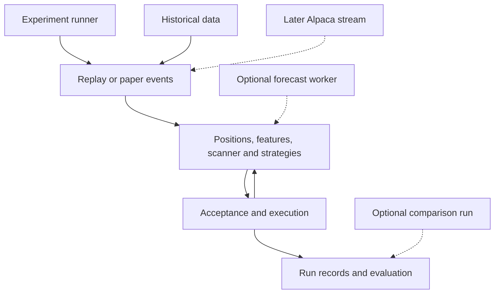

> Markdown snapshot of the 26 October 2026 document. Read `decisions.md` and this pack's supplements for proposed implementation detail.

# Intraday Strategy Research System

Technical stack and module design

Design version 1.0 | 26 October 2026 | Owner Daniel Igbokwe

Build a local research application with a small event-driven replay core, typed strategy proposals and reproducible experiment records. The product definition is the source for objectives and success levels. This design translates the agreed core flow into replaceable modules; it is a specification, not an implementation or a benchmark result.

### Proposed stack

| Area | Technology | Why it is proposed |
| --- | --- | --- |
| Runtime | Python 3.12 baseline | One research language; validate the complete dependency matrix before locking the version. |
| Environment | uv and pyproject.toml | Lock dependencies and reproduce environments; separate core and optional extras. [1] |
| Numeric work | pandas and NumPy | Feature calculations, bar preparation and evaluation. Avoid a DataFrame copy on every event. [2] |
| Data files | PyArrow and Parquet | Typed columnar market data, feature snapshots and trade records. [3] |
| Run index | SQLite via sqlite3 | Local transactional run and trial index without a database server. [4] |
| Contracts and config | Pydantic and YAML safe loading | Validate units, ranges, dependencies and resolved settings. Export JSON Schema. [5] |
| Provider interface | alpaca-py | Historical data and later paper trading behind our adapters. [6] |
| CLI and reporting | argparse, Jinja2 and Plotly | Small command surface and portable HTML reports; no web server needed initially. |
| Quality | pytest, Hypothesis and Ruff | Known-answer, causal and state-transition tests plus linting. |
| Optional forecasting | Kronos and PyTorch | Pinned isolated worker; CPU baseline, hardware acceleration only after measurement. [7] |
| Optional later tools | NautilusTrader; scikit-learn; Optuna | Independent backtest comparison, learned ranking and bounded search when justified. [8] |

These are proposed choices, not a verified install set. Lock exact package versions after a Windows/Linux compatibility smoke test. Keep Kronos dependencies separate if necessary. Nautilus v2 currently has a different Python/API compatibility profile; it may need a separate environment rather than forcing a core upgrade. [8]

Use standard-library timezone-aware UTC timestamps internally and exchange-local session rules. Use Decimal or integer minor units for ledger money and explicit instrument rounding; float arrays are suitable for analytical features with declared tolerances. No Docker, cloud queue, GPU or always-on service is required for the initial historical runner.

## Architecture and ownership

The runner owns configuration and lifecycle. The research core consumes events and emits proposals. The portfolio and execution layers alone change holdings. Optional models and alternative engines remain outside those authority boundaries.

Solid connections describe the initial replay path. Dashed boxes are optional or later components. The detailed event order is specified separately; the diagram shows ownership and dependencies.

### Runtime boundaries

- Run the historical event loop in one process with one deterministic clock. Batch feature preparation where causal; expose only the permitted prefix to a strategy.

- Parallelize independent experiments, not updates to one shared portfolio. Workers write isolated run directories; the coordinator commits their summaries to SQLite through a single writer.

- A forecast worker returns data, not order instructions. The experiment runner measures its latency and exposes a result only after its recorded availability time.

- Paper mode replaces the event source and execution adapter. It retains strategy, scanner and risk rules and records a new stream for later replay parity checks.

## Modules to build and reuse

| Module | Owns | Primary output |
| --- | --- | --- |
| config and registry | Parameter definitions, validation, presets, dependency rules and config hashes. | Resolved immutable config |
| data and calendar | Provider calls, cached snapshots, corporate actions, sessions and QA. | Validated event dataset |
| universe | Historical eligibility and membership versions. | As-of eligible symbols |
| replay | Global event ordering, clock, timers and bounded data views. | Ordered events and timers |
| features | Causal shared indicators, warmup, dependencies and availability. | Feature snapshots |
| scanner | Configurable ranking, refresh cadence, top-N selection and ties. | Candidate snapshots |
| strategies | Setups, confirmation state, entry proposals and declared exits. | Trade proposals |
| acceptance and portfolio | Approval policy, shared cash, sizing, exposure, loss limits and rejections. | Accepted intents or reasons |
| execution and positions | Pending orders, modeled fills, stops, targets and position lifecycle. | Fill and position events |
| models and integrations | Kronos, adapted external rules, optional backend bridges. | Versioned adapter outputs |
| experiments and evaluation | Splits, trials, sweeps, controls, metrics and uncertainty. | Run cards and comparisons |
| storage and reporting | Append-only evidence, run index, exports and trade inspection. | Auditable reports |

### Reuse policy

Use established libraries for serialization, validation, math and provider communication. Build the project-specific scanner, strategy contracts, experiment protocol and reports. Adapt only selected day-trader-skill rules after source review and tests. Do not copy its whole runtime or treat its historical examples as our evidence. [9]

### Repository structure

Use src/rsys/ for these modules, configs/ for versioned experiments, tests/ for fixtures and behavioral checks, and docs/ for decisions. Keep raw data, models, runs and secrets outside Git. Store data manifests, small test fixtures, configuration examples and the trial schema in version control. A run directory holds its resolved config, manifest, event/trade outputs, metrics and report.

## Contracts and causal event order

| Contract | Minimum fields |
| --- | --- |
| Market event | Instrument ID, event type, event time, available time, sequence, source/feed, prices, volume and adjustment metadata. |
| Candidate and features | Decision time, universe/scanner version, rank, feature values, units, missingness, input cutoffs and eligibility reasons. |
| Trade proposal | Proposal ID, strategy/version, symbol, side, decision time, entry rule, expiry, stop, exit policy, feature references and reason. |
| Order and fill | Client order ID, proposal ID, requested/filled quantity, timestamps, status, price, fees and external execution ID where relevant. |
| Forecast | Model and tokenizer pins, input hash, cutoff, availability, horizon/target time, outputs, seed, latency and status. |
| Run record | Run ID, parent hypothesis, phase, config/data/code hashes, dependencies, seeds, account/cost profile, artifacts, status and decision. |

### Order of operations

Order events by available time, then declared event phase and stable sequence. Batch cross-symbol observations at the same decision boundary before ranking; do not let file order choose the first trade. Late or revised information cannot alter an earlier decision.

- At a bar open, evaluate orders already eligible from earlier decisions. Use the new open and previously available state only; recheck affordability, expiry and gap-invalidated stops.

- Account for existing protective exits over the interval. For bars that cannot identify whether stop or target occurred first, use stop-first. A stop gapped through uses a worse executable modeled price.

- At bar completion, expose its final OHLCV to features and strategies. Update the ledger and marks, refresh candidate rankings when scheduled, then evaluate proposals.

- Run acceptance and risk checks; queue new orders for the next permitted event. Stops changed at this close cannot be applied retroactively inside the completed bar.

- Calendar timers enter the same ordered queue at their scheduled times, including early-close flattening. Record every transition and manage all held symbols even if scanner membership changes.

The fill adapter may inspect a completed historical bar to settle previously eligible orders; that OHLCV stays hidden from strategy code until its availability time. For same-open orders, define exit-before-entry priority and a stable tie rule. Finalized historical bars without arrival history are a research proxy, not an exact live replay.

## Data features and strategy interfaces

### Data and calendar requirements

- Cache Alpaca downloads with feed, adjustment, retrieval time, instrument mapping and content hash. Partition bars by instrument and month. Validate monotonic time, duplicates, OHLC bounds, missing intervals and coverage.

- Represent corporate actions explicitly. Keep execution prices and research adjustments distinct and convert prior-session levels to current share units on split dates. Never silently backfill missing prices.

- Build universe membership from historically available data, including delistings where supported. Record coverage gaps and survivorship limitations. Price and liquidity screens do not prove a stock is historically tradable.

- Import a dated exchange calendar, including early closes. Use UTC for storage, exchange-local session grouping and explicit bar-start/bar-end labels. No fixed UTC opening time or hard-coded 15:55 exit on shortened sessions.

### Feature and scanner contracts

Each feature specifies name, version, units, inputs, lookback, warmup, availability and update rule. Same-time relative volume compares the observed interval with the same interval in previous sessions. Daily ATR uses prior completed daily bars. Intraday true range uses the previous completed bar close. A first-30-minute market feature is unavailable before that window closes.

The scanner declares refresh cadence, minimum data, score, filters, top-N and tie policy. Log snapshots at every decision boundary used by a strategy. A static eligible universe is a control; dynamic top gainers must be calculated at the replay time. Cache keys include data, feature versions, parameters and information cutoff.

### Strategy contract

A strategy exposes its ID/version, parameter schema, required features, warmup and an event handler consuming an immutable AsOfView plus its own state. It returns zero or more proposals or exit-change requests. It cannot read raw future arrays, write the cash ledger or call a broker. The core owns clock, data access and portfolio state.

Before implementation, each family needs a setup state machine: idle, qualifying, confirmed, triggered, invalidated or expired. Define the pattern window without the current breakout bar, swing confirmation lag, entry cutoff, stop/target rounding, re-entry rule and maximum holding time. Bullish-first-candle and range-breakout entries are separate variants.

### Registry and constraints

Store parameter type, units, default or unset status, valid set/range, dependencies, rationale and approval status. Reject incompatible combinations and unresolved required settings. Risk limits are not optimized alongside signals. Symbol, timeframe, session, scanner, exit and model settings all participate in the run fingerprint.

## Account execution and integration boundaries

### Basic historical execution

Start with next-eligible-bar market entry, configurable spread/slippage/fees, conservative ambiguous exits and session flattening. Detailed queue position and market impact are deferred. Use only prior known liquidity for sizing; the final volume of an entry bar is future information at its open.

Reserve cash for pending entries. Use the actual modeled entry and costs to revalidate quantity and stop risk; never spend more than the account profile permits. Keep realized and marked unrealized P&L, holdings, reservations and unavailable proceeds distinct. Track order states through accepted, pending, filled, canceled, expired or rejected. Protective exits have priority over new proposals.

Cash availability, settlement and broker restrictions belong to a dated account profile. Do not assume the imported PDF's cash-account or regulatory claims apply to the actual Alpaca account. A software invariant is equity equals cash plus marked holdings, with external flows and fees reconciled; equity is not just cumulative closed-trade P&L while positions remain open.

### External components

| Component | Proposed role and boundary |
| --- | --- |
| Claude day-trader-skill | Inspect scanner, entry/exit and risk workflows. Convert selected rules into deterministic tested modules; keep MIT attribution and record source commit. No automatic installation or conversational approval dependency in baseline replay. [9] |
| Kronos | Optional isolated PyTorch inference worker. Pin model/tokenizer and code, record seeds and CPU/device metadata, return a typed forecast. No sizing or order authority. [7] |
| NautilusTrader | Optional alternate backtest backend or independent comparison. Normalize fills and metrics and explain differences; agreement does not prove profitability. Pin matching runtime and docs. [8] |
| Alpaca paper | Later DataSource and ExecutionAdapter using alpaca-py. Separate credentials and paper host, persist client IDs, reconcile uncertain submission outcomes before retry. [6,10] |

Kronos evaluation must occur after a verified training boundary or conservatively after checkpoint publication. A forecast cannot act before computation finishes or after its target expires. Compare simple forecasts, the rule baseline, a latency-matched baseline and the model filter on the same eligible decisions. Sampled paths are not calibrated win probabilities.

Nautilus is not a first-release dependency. Current upstream discussion still distinguishes community Alpaca work from a future official adapter; a backend change requires an explicit integration test. Paper fills also omit live execution effects, so paper data cannot by itself calibrate realistic market impact or latency slippage. [8,10,11]

## Experiment execution and evaluation

### Runner responsibilities

A run specification binds the hypothesis, phase, chronological split, universe and feed, strategy/scanner/exit versions, parameters, account/cost profile, seeds and data snapshot. Validate it before execution, reserve a unique run ID, then write status transitions and artifacts atomically. Failed runs retain their configuration and error.

- Support baseline, bounded grids, paired component comparisons and chronological walk-forward runs. Add adaptive optimization only inside the development split with a registered budget. All manual variants and seed attempts count in the trial ledger.

- Separate scanner contribution, entry timing, exit policy and model contribution before combinations. Matched entry controls use eligible stocks and times; a control never receives tomorrow's scanner list or a later-selected stock at the open.

- For exit studies, store full raw observation windows and rerun each exit rule causally. Never choose a future maximum as the actual target. Recheck the selected policy in the full shared-cash portfolio.

- Purge training labels whose outcome windows overlap evaluation. Declare any boundary embargo. Earlier indicator warmup is allowed; future labels, normalization fitted on evaluation data and later news revisions are not.

### Metrics and uncertainty

Compute net return and marked equity, drawdown/duration, average net trade, profit factor, average win/loss, turnover, costs, exposure and monthly/symbol breakdowns. R uses the declared initial trade risk denominator; retain price R and dollar risk definitions. Zero-trade, no-loss and missing metrics must have explicit states rather than misleading infinities or zeros.

MFE and MAE are outcomes computed after entry over a declared window. Store fixed-horizon forward returns separately from realized trade P&L. Track entry-to-peak time, exit giveback and stop-out-then-recovery as diagnostics, with every decision evaluated without future access.

Estimate uncertainty using dependence-aware daily portfolio resampling, preserving cross-symbol and multi-day structure. Declare confidence levels, block lengths and trial accounting before scoring. A t-stat cutoff is not a universal correction for many searches. Selection and the final assessment remain separate; too few observations are inconclusive.

### Persistence and comparison rules

SQLite stores run/trial status, hashes, summaries and artifact paths. Parquet stores events, snapshots, trades and daily equity. Preserve complete resolved settings, dependency lock, code revision/dirty diff, input hashes and forecast cache provenance. Fingerprints identify inputs, while run IDs distinguish attempts. Only the coordinator writes the shared index.

Compare candidates on the same eligible dates, capital, costs and exclusions. Publish exclusions before outcomes. Independent fold balances are diagnostics; a growth curve requires one continuous causally selected account. A final holdout cannot be reopened to select the next candidate after a failure.

## Build milestones and acceptance tests

| Milestone | Deliverable | Acceptance evidence |
| --- | --- | --- |
| M0 Specification | Decision register, registry and pinned environment. | Unknown required settings rejected; dependency smoke test passes. |
| M1 Data and replay | Validated snapshots, calendars, one clock and bounded views. | Known sequence reproduced; later-data mutation cannot change earlier outputs. |
| M2 Account and controls | Cash ledger, basic fills/exits, cash control, ORB and VWAP. | Hand-calculated trades reconcile; gaps, ties and costs match the specification. |
| M3 Research workflow | Scanner, run/trial storage, reports and controlled comparisons. | Single changed component identifiable; failed trials retained; reruns reproducible. |
| M4 Strategy expansion | One new family at a time and bounded tuning. | Mechanical spec, causal fixtures and development-only experiments for each family. |
| M5 Evidence and models | Frozen validation; optional Kronos comparisons. | No split leakage; model coverage and latency reported; uncertainty and all outcomes published. |
| M6 Paper observation | Shared logic, paper adapter, reconciliation and records. | Recorded-stream parity; no duplicate orders on retry; frozen cohort and incident report. |

### Tests that protect research conclusions

- Causality: perturb future prices, volumes, universe membership, news and model output; earlier features, ranks, proposals and decisions remain unchanged. Test cross-symbol simultaneous events and confirmed swing lags.

- Economics: insufficient cash, fractional/whole-share rounding, pending reservations, fees, price gaps, ambiguous stops, end-of-day marks and early closes match hand calculations.

- Data: conflicting duplicates, missing intervals, zero volume, splits, stale features and timezone transitions fail clearly or create declared eligibility exclusions.

- Experiments: protected splits, failed-trial retention, immutable artifacts and deterministic seeds work. Synthetic noise tests check expected behavior statistically, not a demand that every random sample lose; planted effects check detection plumbing.

- Paper: partial fills, cancel races, unknown submission status, disconnects and restart recovery preserve one order identity and a reconcilable ledger. These tests are required before paper observation, not for the first offline baseline.

### Practical performance and security

Measure wall time, peak memory and storage on a declared symbol/day fixture before setting performance targets. Load partitions and cache causal calculations rather than loading the whole market. Keep credentials in environment variables or an OS secret store, exclude them from logs and version control, and back up both data manifests and run evidence. No credential is needed for offline fixture tests.

## Decisions and implementation references

### Decisions needed before dependent work

| Decision | Proposed direction or required input |
| --- | --- |
| Acceptance policy | Automatic mechanical rules in historical runs; owner must confirm. Treat AI or manual selection as a separate policy with its own recorded decisions. |
| Scope and bars | Stocks/ETFs first; propose regular-session long-only bars and one-minute storage with causal five-minute aggregation. Confirm interval and initial universe. |
| Risk and account | Confirm trade risk, daily loss and account drawdown limits, simultaneous positions, re-entry, quantity increments and actual Alpaca account profile. |
| Data and funding | Verify SIP/IEX access, historical coverage, historical universe availability and costs. Confirm whether expenses or deposits affect the $1,000 account. |
| Research boundaries | Register untouched dates, sample-size requirements, trial budget, confidence method and numerical promotion gates before experiment results. |
| Interface and models | Confirm CLI/report delivery first. Benchmark optional Kronos hardware; choose model/checkpoint after compatibility and provenance review. |

The system must not silently inherit conflicting defaults from earlier plans. Schemas, fixtures and document review can progress while dependent choices remain open. Resolve each decision before implementing the behavior it controls.

### References and provenance

Source requirements: owner discussions, handwritten research flow and supplied Intraday Strategy Research System Build, Test & Tune Plan. Strategy and evaluation thresholds remain proposals.

[1] uv environment management https://docs.astral.sh/uv/

[2] pandas documentation https://pandas.pydata.org/docs/

[3] Apache Arrow and Parquet https://arrow.apache.org/docs/python/

[4] SQLite interface https://docs.python.org/3/library/sqlite3.html

[5] Pydantic validation https://docs.pydantic.dev/latest/

[6] Alpaca Python SDK https://alpaca.markets/sdks/python/

[7] Kronos https://github.com/shiyu-coder/Kronos

[8] Nautilus runtime and compatibility https://github.com/nautechsystems/nautilus_trader

[9] Day trader workflows https://github.com/Jakeschincariol/day-trader-skill

[10] Paper execution assumptions https://docs.alpaca.markets/us/docs/paper-trading

[11] Alpaca adapter discussion https://github.com/nautechsystems/nautilus_trader/issues/3374

Primary project documentation reviewed 26 October 2026. Recheck compatibility and provider capabilities at implementation; no dependency installation, trading experiment or performance claim is verified by this design alone.

## Architecture diagram (text equivalent)

